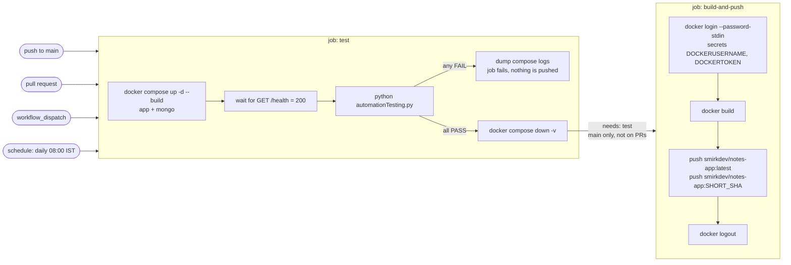
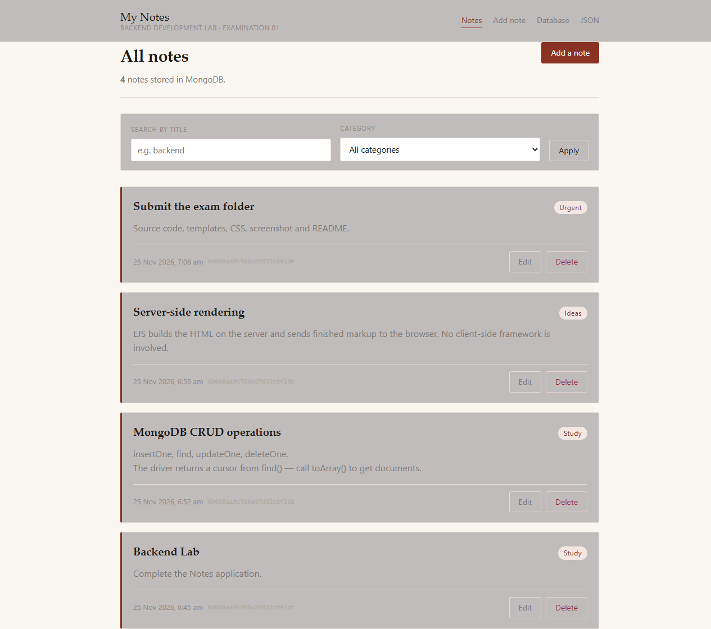
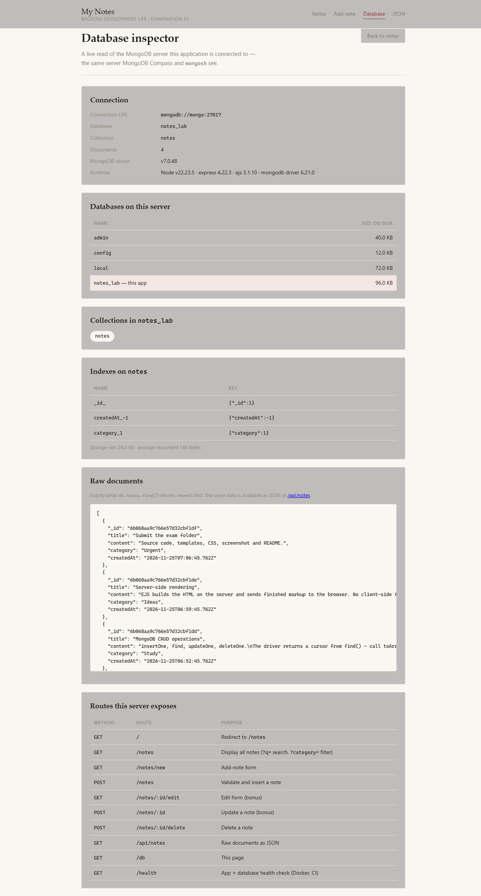
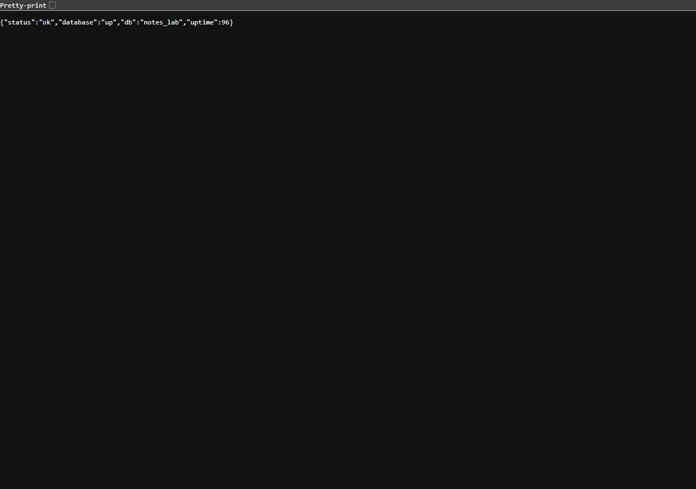

# My Notes — PBL: Docker + automated API tests + GitHub Actions CI/CD

[](https://github.com/smirk-dev/Backend-PBL/actions/workflows/ci-cd.yml)
[](https://hub.docker.com/r/smirkdev/notes-app)

**Suryansh Mishra · SAP ID 590012069** — Backend Development (CSFS3008P), B.Tech Sem 5, UPES.
PBL assignment for Theory Unit 4. Main course repository:
**<https://github.com/smirk-dev/BackendDevelopment>**

The PBL (end of `Theory/Unit 4/001 Combined Hands On Task.md`) asks for five things, in a new repository:

| # | Requirement | Where it is |
|---|---|---|
| 1 | Replace the main source with a previous project (todo / notes / blog / CMS / student app) | The **My Notes** app from my Lab Examination 01 (Express + EJS + native MongoDB driver): `app.js`, `db.js`, `views/`, `public/` |
| 2 | Containerize it with a Dockerfile | [`Dockerfile`](Dockerfile), [`.dockerignore`](.dockerignore) |
| 3 | `docker-compose.yml` to run the service | [`docker-compose.yml`](docker-compose.yml) — the app plus a `mongo` service |
| 4 | `automationTesting.py` to test all routes | [`automationTesting.py`](automationTesting.py) — 55 checks over every route |
| 5 | GitHub Action: run the tests, then build and push the image to Docker Hub | [`.github/workflows/ci-cd.yml`](.github/workflows/ci-cd.yml) → [`smirkdev/notes-app`](https://hub.docker.com/r/smirkdev/notes-app) |

---

## The pipeline



Same thing as text:

```
push / PR / manual / daily cron
        │
        ▼
 ┌──────────────── job: test ────────────────┐
 │ docker compose up -d --build  (app+mongo) │
 │ wait for GET /health → 200                │
 │ python automationTesting.py   (55 checks) │──── FAIL ──► logs dumped, pipeline stops
 │ docker compose down -v                    │
 └───────────────────────────────────────────┘
        │ needs: test   (main branch only — PRs stop here)
        ▼
 ┌──────────── job: build-and-push ──────────┐
 │ docker login --password-stdin             │
 │ docker build                              │
 │ docker push smirkdev/notes-app:latest     │
 │ docker push smirkdev/notes-app:<sha7>     │
 │ docker logout                             │
 └───────────────────────────────────────────┘
```

Why it is built this way:

- **Tests run before the image is published.** `build-and-push` has `needs: test`, so an image is only
  pushed from code that has just passed every route test. A broken commit never reaches Docker Hub.
- **The tests run against the real container**, not `node app.js` on the runner: the job starts the same
  `docker-compose.yml` I use locally, so it also proves the Dockerfile, the compose wiring and the MongoDB
  connection work. That is the "application test vs container smoke test" difference from L42-L43 —
  this pipeline does both in one job.
- **Pull requests are tested but never pushed.** The `if:` on `build-and-push` skips it for
  `pull_request` events and for any branch other than `main`.
- **It runs every day on its own** (`schedule: cron "30 2 * * *"`, 08:00 IST). Even with no new commits
  the daily run rebuilds on the latest `node:22-alpine` and `mongo:7`, re-runs all the tests and pushes a
  fresh `latest`, so a base-image or dependency problem shows up the next morning instead of at the next
  commit. (GitHub pauses scheduled workflows after 60 days without repository activity — a push or a
  manual run turns it back on.)
- **Two tags per image.** `latest` is convenient; the 7-character commit SHA tag is immutable, so any
  deployment can say exactly which commit it runs, and rolling back is just running the previous SHA tag:
  `docker run ... smirkdev/notes-app:<older sha>`.
- **Secrets never touch the repo or the logs.** The Docker Hub token is a GitHub Actions secret, passed to
  `docker login` on stdin (`--password-stdin`), and `docker logout` runs even if a step fails. Locally the
  token lives in `.env`, which is in both `.gitignore` and `.dockerignore`.

---

## The app

The **My Notes** app from Lab Examination 01, unchanged apart from what the PBL needed:

| Method | Route | What it does |
|---|---|---|
| GET | `/` | Redirects to `/notes` |
| GET | `/notes` | All notes, newest first. `?q=` searches titles, `?category=` filters |
| GET | `/notes/new` | Add-note form |
| POST | `/notes` | Validates and inserts; invalid input re-renders the form with **422** |
| GET | `/notes/:id/edit` | Edit form (bad or unknown id → **404**) |
| POST | `/notes/:id` | Saves an edit (422 on invalid input, 404 on unknown id) |
| POST | `/notes/:id/delete` | Deletes a note (404 on unknown id) |
| GET | `/api/notes` | All documents as JSON |
| GET | `/db` | Live MongoDB inspector page |
| GET | `/health` | **Added for the PBL** — `200 {"status":"ok","database":"up"}` only if MongoDB answers a ping, `503` otherwise |

Changes made for the PBL:

- `GET /health`, used by the Dockerfile `HEALTHCHECK`, by the workflow's wait step and by the tests.
- A `SIGTERM` handler: inside a container Node runs as PID 1 and ignores `SIGTERM`, so `docker stop` used
  to wait 10 s and then kill it. Now it closes the server and the Mongo pool and exits in about a second.
- `MONGO_URL` / `DB_NAME` / `PORT` were already read from the environment (local default
  `mongodb://127.0.0.1:27017` kept), so compose just sets `MONGO_URL=mongodb://mongo:27017`.

## Files

```
app.js, db.js, seed.js, views/, public/   the Express app (from Lab Exam 01)
Dockerfile                                node:22-alpine, npm ci --omit=dev, runs as user "node", HEALTHCHECK on /health
.dockerignore                             keeps node_modules, .git, .env, tests and docs out of the image
docker-compose.yml                        app (built from the Dockerfile) + mongo:7 with a healthcheck and a named volume
automationTesting.py                      route tests with requests — PASS/FAIL per check, exit 1 on any failure
requirements-test.txt                     requests, for the test script
.github/workflows/ci-cd.yml               the pipeline above
```

---

## Run it locally

Needs Docker Desktop (or Docker Engine with the compose plugin) and Python 3 for the tests.

```bash
git clone https://github.com/smirk-dev/Backend-PBL.git
cd Backend-PBL

docker compose up -d --build          # app on http://localhost:3000
# APP_PORT=3050 docker compose up -d --build    if port 3000 is taken

docker compose exec app node seed.js  # optional: 4 sample notes
docker compose ps                     # both services should say (healthy)
curl http://localhost:3000/health

pip install -r requirements-test.txt
python automationTesting.py           # or: BASE_URL=http://localhost:3050 python automationTesting.py

docker compose down -v                # stop and delete the containers and the mongo volume
```

Without Docker: `npm install` then `npm start` uses a MongoDB on `mongodb://127.0.0.1:27017`.

Run the published image instead of building it:

```bash
docker network create notes-net
docker run -d --name notes-mongo --network notes-net mongo:7
docker run -d --name notes-app --network notes-net -p 3000:3000 \
  -e MONGO_URL=mongodb://notes-mongo:27017 smirkdev/notes-app:latest
curl http://localhost:3000/health
```

### automationTesting.py

Follows the `testAutomation.py` pattern from L44-L45 (`requests` + test cases + assertions), extended
for a CRUD app: it creates its own note with a random marker, walks it through every route, checks the
response codes, redirects, HTML and the JSON in MongoDB, and deletes everything it created at the end.

- `BASE_URL` (env or first argument), default `http://localhost:3000`
- `WAIT_SECONDS` — how long to wait for `/health` before giving up (default 30)
- Covers: health, `/` redirect, list, new form, create, validation (empty title, empty content,
  title over 120 chars, whitespace only → 422 with the message and the typed input kept), search
  (match, case-insensitive, no match, regex characters taken literally), category filter, search +
  category together, edit form, update, invalid update → 422, bad / unknown ids → 404 on edit, update
  and delete, unknown page → 404, `/api/notes`, `/db`, static CSS, delete, delete again → 404.

### One-time setup of the Docker Hub secrets

```bash
# Docker Hub → Account settings → Personal access tokens → Read & Write token
gh secret set DOCKERUSERNAME --body smirkdev
gh secret set DOCKERTOKEN < token.txt     # value piped in, never typed into the shell history
```

---

## Checks run

Local run, Windows 11 + Docker Desktop 29.5.2, compose project `pbl`, app on host port 3050:

```
$ APP_PORT=3050 docker compose -p pbl up -d --build
 Container pbl-mongo-1 Healthy
 Container pbl-app-1 Started

$ docker compose -p pbl ps
NAME          IMAGE                    STATUS                    PORTS
pbl-app-1     smirkdev/notes-app:dev   Up 17 seconds (healthy)   0.0.0.0:3050->3000/tcp
pbl-mongo-1   mongo:7                  Up 25 seconds (healthy)   27017/tcp

$ curl -i http://localhost:3050/health
HTTP/1.1 200 OK
Content-Type: application/json; charset=utf-8
{"status":"ok","database":"up","db":"notes_lab","uptime":5}

$ BASE_URL=http://localhost:3050 python automationTesting.py
Testing http://localhost:3050  (run 5e68837f)
PASS  GET /health returns 200
PASS  GET /health reports status ok and database up
PASS  GET / redirects to /notes
PASS  GET /notes returns 200 HTML
...
PASS  POST /notes (empty title) returns 422
PASS  POST /notes (empty title) shows the error message
...
PASS  regex characters are searched literally (q=.*)
...
PASS  GET /notes/000000000000000000000000/edit returns 404
...
PASS  deleting the same note again returns 404
------------------------------------------------------------
55 passed, 0 failed, 55 total
All tests passed!
```

Failure paths checked too:

```
# MongoDB stopped while the app keeps running -> health goes red
$ docker compose -p pbl stop mongo
$ curl -w ' [%{http_code}]' http://localhost:3050/health
{"status":"error","database":"down","detail":"getaddrinfo ENOTFOUND mongo"} [503]

# Nothing listening -> the test script fails the run with a non-zero exit code
$ WAIT_SECONDS=2 python automationTesting.py http://localhost:3059
FAIL  server is reachable at http://localhost:3059/health  ->  no 200 within 2s
0 passed, 1 failed, 1 total
$ echo $?
1

# Clean shutdown on SIGTERM
$ time docker compose -p pbl stop app
real    0m1.189s
app-1  | SIGTERM received, shutting down

# The image runs as a non-root user and contains no .env / tests / .git
$ docker compose -p pbl exec app sh -c 'whoami; ls -a /app'
node
.  ..  app.js  db.js  node_modules  package-lock.json  package.json  public  seed.js  views
```

Screenshots (app running in the container, talking to the compose `mongo` service):

| Notes list | Database inspector (`mongodb://mongo:27017`) | `/health` |
|---|---|---|
|  |  |  |

GitHub Actions runs (every one ran `test` and then `build-and-push`):

| Trigger | Commit | Result | Run |
|---|---|---|---|
| push to main | `fbe6b41` | test 55/55 passed, pushed `latest` + `fbe6b41` | [45567034754](https://github.com/smirk-dev/Backend-PBL/actions/runs/45567034754) |
| push to main | `fae426f` | test 55/55 passed, pushed `latest` + `fae426f` | [45567272233](https://github.com/smirk-dev/Backend-PBL/actions/runs/45567272233) |
| workflow_dispatch (manual) | `fae426f` | test 55/55 passed, pushed `latest` + `fae426f` | [45567431556](https://github.com/smirk-dev/Backend-PBL/actions/runs/45567431556) |
| schedule (daily 02:30 UTC) | — | runs every morning; see the [Actions tab](https://github.com/smirk-dev/Backend-PBL/actions/workflows/ci-cd.yml?query=event%3Aschedule) | — |

From the `test` job log:

```
app is healthy after 2 tries
55 passed, 0 failed, 55 total
All tests passed!
```

From the `build-and-push` job log (workflow_dispatch run):

```
Login Succeeded
latest: digest: sha256:3306a2af0e7d8c80a9cf3cd6b13e0712d4f19aaf30927fc7308204ab3852f161 size: 856
fae426f: digest: sha256:3306a2af0e7d8c80a9cf3cd6b13e0712d4f19aaf30927fc7308204ab3852f161 size: 856
Removing login credentials for https://index.docker.io/v1/
```

The published image, pulled back from Docker Hub and tested on a clean network:

```
$ docker pull smirkdev/notes-app:latest
docker.io/smirkdev/notes-app:latest          (digest sha256:3306a2af...f161, user=node)

$ docker network create pbl-verify
$ docker run -d --name pbl-verify-mongo --network pbl-verify mongo:7
$ docker run -d --name pbl-verify-app --network pbl-verify -p 3051:3000 \
    -e MONGO_URL=mongodb://pbl-verify-mongo:27017 smirkdev/notes-app:latest
$ curl -i http://localhost:3051/health
HTTP/1.1 200 OK
{"status":"ok","database":"up","db":"notes_lab","uptime":2}
$ curl -o /dev/null -w '%{http_code}' http://localhost:3051/notes
200
$ BASE_URL=http://localhost:3051 python automationTesting.py
55 passed, 0 failed, 55 total
All tests passed!
```
